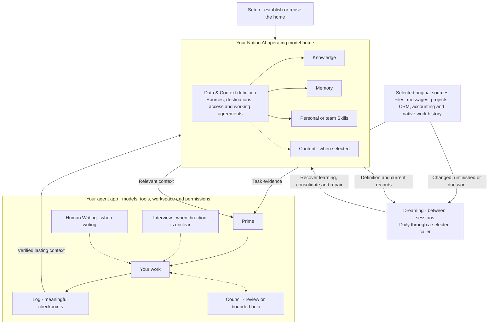

## How OSM works

Your agent uses OSM to find relevant business context, save useful learning and keep that context current. The diagram shows the seven skills, your Notion AI operating model home and the connected sources.

<embed source="notion-file-block://41e6d2e1-7f56-8199-90a1-d50b4514046c/f120ad6c-761b-42af-8c47-bec69ffe3747?space_id=eee27a39-7e8a-48e6-9bd4-f3bc51a333fe&name=osm-architecture.html" />

### The working relationships

Prime reads what a task needs. Log saves lasting changes at checkpoints. Dreaming checks recent work and selected sources under the same curation rules. Council is optional.

The diagram adapts to the available width. The relationship map above shows the main reading and maintenance paths.

The layers describe responsibilities, not a mandatory sequence. The foundation supplies relevant context for useful AI work. Learning and accepted changes help maintain it. Connected systems retain their originals.

## 🧩 Content · optional extension

The same foundation supports a configurable Content extension. The diagram follows the material: idea → plan/script → actual original → reviewed editions → published outputs → learning. Setup is the foundation beneath the flow.

<image source="notion-file-block://59fa633d-81d7-433f-8059-76d02b192d6f/dc2e09c1-6252-4c3a-9a99-6ecc529afcca?space_id=eee27a39-7e8a-48e6-9bd4-f3bc51a333fe&name=content-material-flow-mobile.png" />

Prepare supports pre-production and creating the actual original. Produce / Distribute covers finishing/post-production, useful adaptations and delivery. Response informs the next idea and configuration. Existing material can enter where it needs help; long and short form are choices. Human judgement, analog work and selected tools remain part of the workflow.

## Editable sources

Current Content material-flow diagrams: wide and mobile PNG/SVG, renderer, palette and SHA-256 manifest.

<file source="notion-file-block://d109739d-6ba8-44f8-81b2-b812755c60fe/b610b8b5-77cf-422b-aef0-c22b3e2122cb?space_id=eee27a39-7e8a-48e6-9bd4-f3bc51a333fe&name=content-material-diagrams-20261105.zip" />

The earlier foundation/diagram source packet is retained below for historical reference.

<file source="notion-file-block://45182f44-5e5b-492e-bbc7-8e45307f324b/d88f3e17-5969-4b82-9d2b-675829343422?space_id=eee27a39-7e8a-48e6-9bd4-f3bc51a333fe&name=osm-diagrams-20261104.zip">
Four editable SVG diagrams, the renderer, the observed onlinesourdough palette and SHA-256 manifest.
</file>

Colours were read from the public onlinesourdough website on <date start="2026-11-04" />: warm paper, brown text and the brown brand accent. The diagram layout uses clear layers and nested responsibilities, following the Agentic Systems reference.
