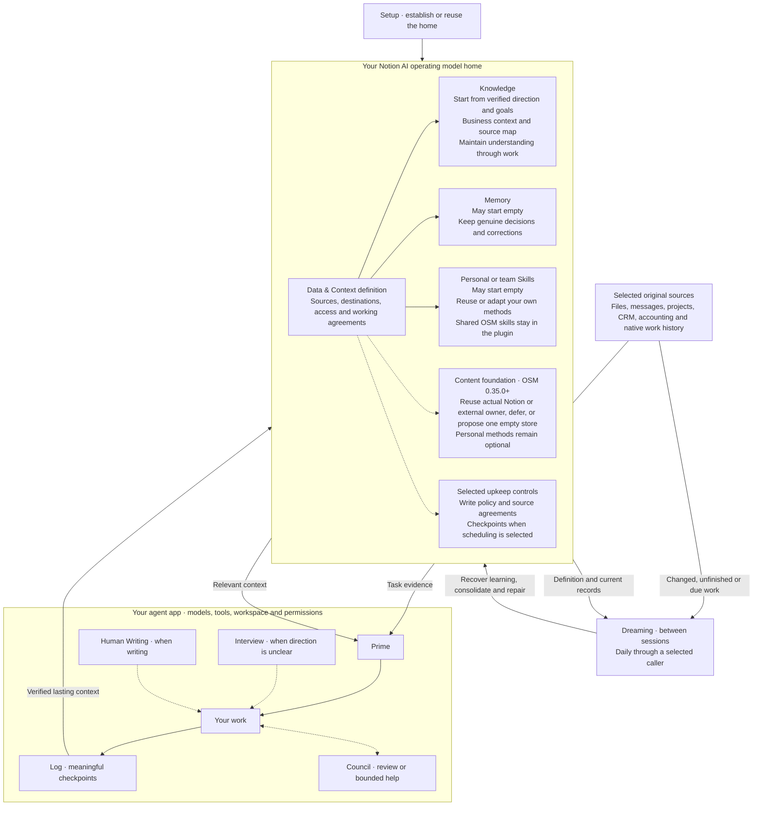

## How OSM works

Your agent uses OSM to find relevant business context, save useful learning and keep that context current. The diagram shows the seven skills, your Notion AI operating model home and the connected sources.

<image source="notion-file-block://4206d2e1-7f56-8126-82bb-f17d1ef089a1/9cbc5d1f-f0f0-4437-8a06-786ac92bb619?space_id=eee27a39-7e8a-48e6-9bd4-f3bc51a333fe&name=osm-architecture.png" />

<toggle>
Mobile overview

<image source="notion-file-block://4206d2e1-7f56-819d-ba84-e027b5b1b7bf/1a3c873f-f933-487f-acda-f78d266078eb?space_id=eee27a39-7e8a-48e6-9bd4-f3bc51a333fe&name=osm-architecture-mobile.png" />
</toggle>

<toggle>
Editable relationship map · Mermaid

</toggle>

Prime reads what a task needs. Log saves lasting changes at checkpoints. Dreaming checks recent work and selected sources under the same curation rules. Council is optional.

The diagram separates useful starting context from what grows through actual work. Memory may start empty. Knowledge topics and personal methods are selected for the business; they are not a mandatory file set. The seven shared OSM skills stay in the plugin. New-home Setup resolves the Content foundation in OSM 0.35.0 or later; update the plugin before using that behaviour. Its route can stay external or deferred, with no parallel Notion store. The optional Content module reuses that binding.

A mobile overview and the editable HTML and relationship sources are available on this page.

The layers describe responsibilities, not a mandatory sequence. The foundation supplies relevant context for useful AI work. Learning and accepted changes help maintain it. Connected systems retain their originals.

## 🧩 Content · optional methods

The core foundation resolves where Content belongs. The optional Content library helps adapt personal methods to the owner’s existing workflow, using the same registered route. Source, Content and Edition are record roles, not a compulsory sequence; a short original can stand alone. No editorial method or publication is installed automatically.

See the current material-flow diagram, examples and editable sources in <mention url="https://app.notion.com/p/40d6d2e17f5681219a81e13317a19339">Content · optional extension</mention>. Direction, audience and voice remain in Knowledge; actual production and channel editions stay with their selected owner.

## Editable sources

<toggle>
Responsive diagram · editable HTML

<embed source="notion-file-block://4206d2e1-7f56-81f9-9e51-eea62b99d90b/15940922-6644-45b3-821b-e81b42371880?space_id=eee27a39-7e8a-48e6-9bd4-f3bc51a333fe&name=osm-architecture.html" />
</toggle>

Historical Content material-flow bundle; current diagrams and editable sources are maintained in the linked OSM Content guide.

<file source="notion-file-block://d109739d-6ba8-44f8-81b2-b812755c60fe/b610b8b5-77cf-422b-aef0-c22b3e2122cb?space_id=eee27a39-7e8a-48e6-9bd4-f3bc51a333fe&name=content-material-diagrams-20261105.zip" />

The earlier foundation/diagram source packet is retained below for historical reference.

<file source="notion-file-block://45182f44-5e5b-492e-bbc7-8e45307f324b/d88f3e17-5969-4b82-9d2b-675829343422?space_id=eee27a39-7e8a-48e6-9bd4-f3bc51a333fe&name=osm-diagrams-20261104.zip">
Four editable SVG diagrams, the renderer, the observed onlinesourdough palette and SHA-256 manifest.
</file>

Colours were read from the public onlinesourdough website on <date start="2026-11-04" />: warm paper, brown text and the brown brand accent. The diagram layout uses clear layers and nested responsibilities, following the Agentic Systems reference.
