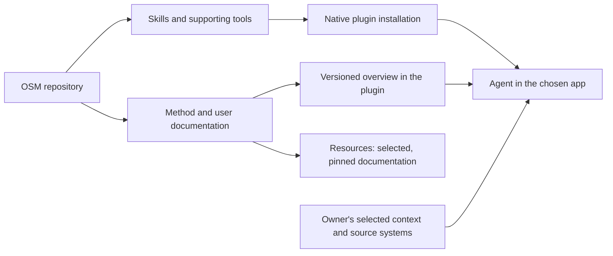

# Documentation

The Onlinesourdough Method (OSM) is maintained in this repository. The plugin
distributes the method as skills and supporting tools. Resources presents
selected documentation for people; it is a reader of this source.

## Choose a starting point

| Question | Read |
| --- | --- |
| What is OSM, and how do I start? | [Repository introduction](../README.md) |
| What does my installed version provide? | [Versioned OSM overview](osm.md), shipped with the plugin |
| How do the parts and their responsibilities fit together? | [Architecture](architecture.md) |
| Which method should I use? | [Skill index](skills.md), then the relevant skill |
| How do I install, update, switch or recover an app registration? | [Native installation](native-installation.md) |
| How is my context home organised, what may agents write there, and how are records kept current? | [Context Architecture](../skills/osm-data-context/references/architecture.md): its [home write policy](../skills/osm-data-context/references/architecture.md#home-write-policy) and [record lifecycle](../skills/osm-data-context/references/architecture.md#record-lifecycle) |
| What does the Codex panel actually do? | [Sidebar](sidebar.md) |
| How is the public Notion guide kept aligned, and who writes what? | [Publication](publication.md) |
| How do I contribute? | [Repository contract](../AGENTS.md) |

An agent can use the installed [documentation route](../skills/osm/references/documentation.md)
to select one relevant source. Reading this whole library is unnecessary.

## One source, different uses

| Material | Canonical owner |
| --- | --- |
| Reusable methods and executable helpers | The relevant `skills/` directory; documentation explains and links to it |
| Package behavior and capabilities | Source, manifests and verification for the selected revision |
| User introduction and installation examples | Root README; detailed app behavior and limits stay in the linked guides |
| The installed agent's overview | `docs/osm.md`, versioned with the package |
| Public teaching and presentation | Resources owns its lessons and presentation; selected product documentation remains owned here |
| Company facts, decisions and personal methods | The owner's chosen context home and authoritative sources, outside this repository |
| Project deliverables and live work | Their own project and operational systems |

Git owns the executable method instructions: the skills and their references. The
public Notion guide, [The Onlinesourdough Method](https://gustavanderson.notion.site/The-Onlinesourdough-Method-40d6d2e17f568124af82ceb93dabf77a),
is a versioned explanatory and reference projection of them. Its released edition
reflects v0.30.0 (`314dcf1`); this working branch is newer and unreleased, so the
guide is never the installed method and never proof of what a given install does.
The guide's Content templates are a separate Notion-authored draft edition; that
edition, not the preserved Git drafts under [content-drafts](content-drafts/README.md),
is the current template source. How the projection is kept aligned, and what is
and is not yet automated, is in [publication](publication.md). A customer's Notion
context home is a different, customer-owned destination. Agentic Systems is a separate
method and package; its documentation is not copied into OSM.

### What a statement can mean

Documentation here separates four states, and no text should blur them:

| State | Meaning | Where to look |
| --- | --- | --- |
| Declared | Stated in a manifest, skill or document | The file itself |
| Fixture-tested | A repository check or fixture passes at a recorded commit | [Verification](verification.md); fixture proof is not native or live proof |
| Native-tested | Observed in an installed app | Only what [verification](verification.md) records for that release |
| Released | Published as a GitHub Release | [GitHub Releases](https://github.com/onlinesourdough/OSM-plugin/releases); v0.30.1 is the latest published package (prerelease) |

The public guide and publisher manifest remain frozen at v0.30.0. That projection
is distinct from the latest published package. The newer v0.30.1 tag and current
release sentence intentionally hold the unchanged publisher reconciliation; a
future reviewed publication binding must resolve it before activation.

The skill set on this branch (18 skills, Notion-only core) is declared and
fixture-tested, unreleased and not installed or native-tested anywhere.

### Documentation consumers

Keep the existing entrypoints stable when editing the README:

- Resources selects the introduction and the `Install in your app`,
  `Your context home` and `Start with a real task` sections. Its manifest chooses
  the documents and sections; its lock records the exact source commit and hash.
- The public profile generator reads `Why I built this`. Keep that heading and
  edit its source here when the story changes, rather than patching generated copies.
- An installed agent reads its packaged methods and versioned overview. It does
  not fetch instructions from Resources to perform a task.

The README introduction Resources selects says "The same 18 skills", and the disclosure that this tree is
unreleased sits under `## More`, which that selection omits. A consumer that adopts an untagged
revision shows the 18 with no state; it should pin a tagged release or carry the state itself.

`tests/consumer-selection-rehearsal.py` rehearses both selections locally against this
repository (headings present once and non-empty, links resolvable, no private data); it
deploys nothing and does not run the consumers.

A new guide or renamed heading needs an explicit consumer update. Resources
refreshes and reviews its pinned content through its own workflow; a repo edit
alone does not update the website. Preserve attribution, source links and the
distinction between a released version, `main`, and a preview. An unavailable
refresh must not silently replace the last verified copy or imply it is current.

## Contributing and operating

Use [AGENTS.md](../AGENTS.md) for the working contract and affected checks.
[Ownership](ownership.md), [distribution](distribution.md),
[skill versioning](skill-versioning.md), [verification](verification.md),
[recovery](recovery.md) and [security](../SECURITY.md) serve maintainers.
Open issues and pull requests own unfinished work. The
[changelog](../CHANGELOG.md) records change history, including source candidates;
[GitHub Releases](https://github.com/onlinesourdough/OSM-plugin/releases) own
published versions. Neither an issue, a changelog entry nor a passing fixture
establishes native behavior or installation.

## Earlier names and dated evidence

Use [Earlier names](osm.md#earlier-names) and the
[migration procedure](../skills/osm-setup/references/migration.md) only when
upgrading or recovering an existing installation. AIOS filenames, format
markers, stored keys and managed instruction blocks can be compatibility
contracts. Classify them before changing them; a branding cleanup is not a
user-data migration.

The [archive](archive/README.md) holds dated lifecycle and candidate records;
preservation maps, [verification](verification.md) and `evidence/` retain dated
decisions and implementation proof. Use them to answer
a historical or verification question, then check current skills and source.
They are not an additional onboarding path or an instruction to restore retired
features. `todo.md` explicitly records a retired tracking fallback, not a live
backlog.

Consolidating records keeps needed provenance and recovery proof, accounts for
inbound links and test references, and coordinates with the implementation writer
before files move. Git history preserves the earlier paths; active compatibility and
accepted evidence need a deliberate owner. Nothing was deleted: the twelve archived
records moved unchanged, and the remaining dated documents (preservation maps,
integration proof, home connection and the retired-skill notes) stay because live
documents or skills still link them.
