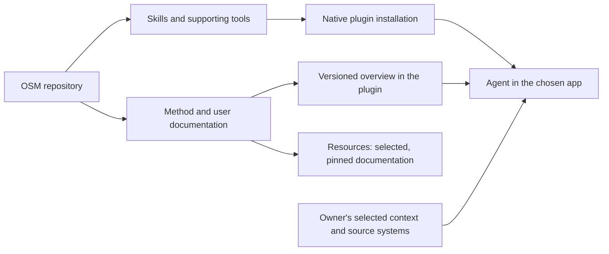

# Documentation

The Onlinesourdough Method (OSM) is maintained in this repository. The plugin
distributes the method as skills and supporting tools. Resources presents
selected documentation for people; it is a reader of this source.

## Choose a starting point

| Question | Read |
| --- | --- |
| What is OSM, and how do I start? | [Repository introduction](../README.md) |
| What does my installed version provide? | [Versioned OSM overview](osm.md), shipped with the plugin |
| How do the parts and their responsibilities fit together? | [Architecture](architecture.md) |
| Which method should I use? | [Skill index](skills.md), then the relevant skill |
| How do I install, update, switch or recover an app registration? | [Native installation](native-installation.md) |
| What does the Codex panel actually do? | [Sidebar](sidebar.md) |
| How do I contribute? | [Repository contract](../AGENTS.md) |

An agent can use the installed [documentation route](../skills/osm/references/documentation.md)
to select one relevant source. Reading this whole library is unnecessary.

## One source, different uses

| Material | Canonical owner |
| --- | --- |
| Reusable methods and executable helpers | The relevant `skills/` directory; documentation explains and links to it |
| Package behavior and capabilities | Source, manifests and verification for the selected revision |
| User introduction and installation examples | Root README; detailed app behavior and limits stay in the linked guides |
| The installed agent's overview | `docs/osm.md`, versioned with the package |
| Public teaching and presentation | Resources owns its lessons and presentation; selected product documentation remains owned here |
| Company facts, decisions and personal methods | The owner's chosen context home and authoritative sources, outside this repository |
| Project deliverables and live work | Their own project and operational systems |

OSM needs no separate Notion edition of its shared method. A customer's Notion
context home is a different, customer-owned destination. Factory is a separate
method and package; its documentation is not copied into OSM.

### Documentation consumers

Keep the existing entrypoints stable when editing the README:

- Resources selects the introduction and the `Install in your app`,
  `Your context home` and `Start with a real task` sections. Its manifest chooses
  the documents and sections; its lock records the exact source commit and hash.
- The public profile generator reads `Why I built this`. Keep that heading and
  edit its source here when the story changes, rather than patching generated copies.
- An installed agent reads its packaged methods and versioned overview. It does
  not fetch instructions from Resources to perform a task.

A new guide or renamed heading needs an explicit consumer update. Resources
refreshes and reviews its pinned content through its own workflow; a repo edit
alone does not update the website. Preserve attribution, source links and the
distinction between a released version, `main`, and a preview. An unavailable
refresh must not silently replace the last verified copy or imply it is current.

## Contributing and operating

Use [AGENTS.md](../AGENTS.md) for the working contract and affected checks.
[Ownership](ownership.md), [distribution](distribution.md),
[skill versioning](skill-versioning.md), [verification](verification.md),
[recovery](recovery.md) and [security](../SECURITY.md) serve maintainers.
Open issues and pull requests own unfinished work. The
[changelog](../CHANGELOG.md) and [releases](https://github.com/onlinesourdough/OSM-plugin/releases)
record delivered versions; neither an issue nor a passing fixture establishes
native behavior or installation.

## Earlier names and dated evidence

Use [Earlier names](osm.md#earlier-names) and the
[migration procedure](../skills/osm-setup/references/migration.md) only when
upgrading or recovering an existing installation. AIOS filenames, format
markers, stored keys and managed instruction blocks can be compatibility
contracts. Classify them before changing them; a branding cleanup is not a
user-data migration.

Files such as `lifecycle-*.md`, `issue-38-onboarding.md`, preservation maps and
`evidence/` retain dated decisions and implementation proof. Use them to answer
a historical or verification question, then check current skills and source.
They are not an additional onboarding path or an instruction to restore retired
features. `todo.md` explicitly records a retired tracking fallback, not a live
backlog.

When consolidating those records, retain needed provenance and recovery proof,
check inbound links and test references, and coordinate with the current
implementation writer before moving files. Git history can preserve obsolete
material; active compatibility and accepted evidence need a deliberate owner.
