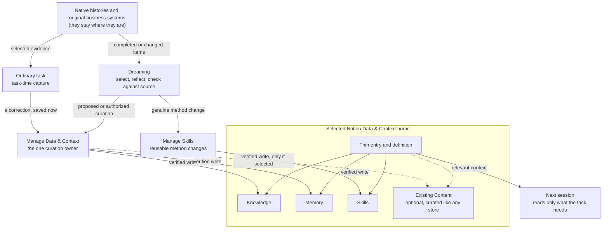

# Architecture

OSM combines portable owner context with Agent Skills for planning, writing
and reviewed delivery. Native manifests load one root `skills/`
directory. Focused helpers belong to their skills and run only for a selected
task; OSM has no model runner, background service or permission system.

| Boundary | Responsibility |
| --- | --- |
| Native harness | Projects, sessions, models, tools, permissions and credentials |
| Selected context home and its short entry | Relevant context, source links, decisions and personal skills |
| Spaces | Selectively loaded business or brand context |
| Skills | Reusable methods, standards and judgment, with references and small helpers as needed |
| Project workspace | Local requirements, working files, outputs, proof and recovery; Git is selected when useful |
| Optional System | A separately maintained specialist with its own dependencies or operational needs |
| Native manifests | Package identity and discovery over the same 18 skills |
| Codex sidebar | A host-managed local MCP App for numbered source setup and a dashboard; stores private navigation names/links, with no company-content copy or chat handoff |

## Work and methods

Continue in the current task and workspace. The shared lifecycle resolves the
outcome, then applies Spec, Build, Review and authorized Ship proportionately.
Visual design uses an installed design method if the host provides one,
otherwise direct work or a reported missing method. There is no chain
configuration language, mandatory department model or fixed sequence between
design and writing. Short writing uses human-writing directly.

Content production and Diffusion Studio are not part of the package since 0.31.0.
Their history stays as non-shipped [Content drafts](content-drafts/README.md); the
design skills were retired in 0.29.0.

Use project-local `design/` and `content/` for working material and create them
when needed. Product files belong where the project consumes them. Skill
packages contain reusable methods and neutral assets, never customer work.
Domain skills own briefs, evidence, review and handoff details; the core router
only selects a method. See the [skill index](skills.md), the historical
[content preservation map](content-preservation.md) and the historical
[design preservation map](design-preservation.md) for the skills retired in 0.29.0.

An optional System is useful for a bounded specialist with independent upkeep,
such as Power BI and its Windows Desktop workflow. Its repository owns its
requirements, dependencies, proof and recovery. A script or a long skill alone
does not require a System. Create Project establishes the appropriate workspace
and context. A selected repository template is an optional seed; it does not add
a second project identity or copy OSM phases. Create System is retired;
reusable methods use Manage Skills. Project Foundation was retired in 0.28.0;
substantial software engineering foundations use a separately selected method,
such as [Agentic Foundation](https://github.com/arcitai/agentic-systems/tree/main/foundation/agentic-foundation),
or the gap is reported. OSM ships no replacement engineering contract.

[Agentic Systems](https://github.com/arcitai/agentic-systems) is a separate package of
Foundation, AgentOps and ADLC methods for T3 Code and native coding agents.
The operator may use it with an OSM-assisted project under the project's
accepted scope. Neither package depends on or installs the other; there is no
runtime integration, shared credential store or automatic software handoff. The
selected execution environment owns its controls.

## Context and isolation

Owner context is selected when the work needs it. Independent repository work
starts from local instructions and accepted inputs, including repositories
nested beneath an owner home. No parent instruction file preloads personal data.
Native project discovery does not depend on an OSM registry. Existing useful
source indexes can remain ordinary context.

Package versions and owner-data formats are separate; installation never
migrates data. Notion is the only supported context home. A legacy folder, vault
or `AIOS_FORMAT` home is recognized read-only and preserved; the
[update reference](../skills/osm/references/update.md#legacy-file-and-vault-homes) gives
the migration guidance and [legacy-file-home](legacy-file-home/README.md) keeps the
retired format and Sync records for history.

[Data & Context](../skills/osm-data-context/SKILL.md) engineers the Notion home and
owns the common home contract. A small host pointer supplies fresh-session
discovery; the entry identifies authoritative sources, Spaces, personal methods
and maintenance scope. Source systems retain their operational records and access
control. External systems, local files and repositories are sources, not homes.

Docs, Skills and Memory establish a context foundation. An operating model also
needs workflows, responsibility, review points and evidence of useful outcomes.
Start from one real workflow and add context where it improves that work. This
package does not provision an ERP, data integration service or runtime memory engine.

One owner per operation: Setup conducts onboarding and calls Data & Context for the
home; Manage Data & Context retrieves and curates under the owner's recorded write
policy, and delegates skill or method changes to Manage Skills, which owns
personal-skill placement and native adoption. The `osm` entry hosts the read-only
check, the update/rollback procedure and on-request model advice.

## Capture, Dreaming and curation

Context enters the home in two ways, and one method writes it. During ordinary
work an important correction is saved when it happens. Between tasks,
[Dreaming](../skills/osm-dreaming/SKILL.md) selects useful completed or changed
work, reflects across it with due or flagged records, and checks what it would
keep against its source. Both hand the write to
[Manage Data & Context](../skills/osm-manage-data-context/SKILL.md), the one
curation owner. A genuine reusable method change goes to
[Manage Skills](../skills/osm-manage-skills/SKILL.md); a note does not become a
skill by itself.

- **Originals stay put.** Operational records and original histories keep their
  own systems and access. Only the history and source routes the host can
  actually read are used; an unavailable route is a reported gap, and
  transcripts are never copied wholesale into the home.
- **Thin entry.** A fresh session starts from the small entry and its
  definition, then reads by metadata before bodies; see
  [retrieval](../skills/osm-data-context/references/architecture.md#retrieval).
- **Dreaming is a caller, not a service.** A person or an existing native
  caller invokes it. It creates no schedule, store or caller, names no model,
  and leaves unchanged content and its dates alone; see the
  [maintenance loop](../skills/osm-data-context/references/architecture.md#maintenance-loop)
  and [item and stage failures](../skills/osm-data-context/references/architecture.md#item-and-stage-failures)
  for how an item still active when found stays pending until it completes.
- **Existing Content is curated like any store.** When the owner has selected a
  Content collection, Manage Data & Context maintains it as a store of context
  with the same lifecycle and write policy, without a Content module and without
  creating one. Producing or publishing content belongs to the separate Content
  method, not to Dreaming or to Manage Data & Context.

This shows who owns what; it is not a runtime, an ingestion service or a claim
that any run happened. Observed behavior and its limits are recorded in
[verification](verification.md), and responsibilities in
[ownership](ownership.md). The accepted architecture boards remain the design
basis; this is their repository-native text form.

## Selective loading

The harness discovers skill names and descriptions. Load the selected skill,
then only the references needed for its operation. Explaining a method does not
execute its lifecycle. Model advice, only on request, assesses the remaining work under the
user's configured default; worker orchestration is conditional on a concrete
gain or a request. Shared continuation retains existing action authority.
Risky Changes applies to consequential changes, without creating routine gates.

Clarify is an included explanation method, separate from visual design. The
Global Skills and Skills Atlas repositories are retained as public archives.
Shape Offer and the former guardrail implementation are not included in OSM.
Explicit protection requests use native harness controls and reviewed maintained
capabilities; installation and actual active protection are verified separately.

## Documentation and native installation

The product repository owns OSM documentation. Its approved overview at
`docs/osm.md` ships in the native package and states the matching package
version. The primary OSM skill points to a small
[documentation route](../skills/osm/references/documentation.md), which selects
only the local overview or method reference needed for a question. Including a
file in the package does not preload it into conversation context.

Current releases, changed external facts and gaps in local documentation use the
[canonical source route](../skills/osm/references/canonical-sources.md).
The installed version stays distinct from upstream `main` and newer releases.
Private source reads use already-authorized access. Local documentation and
methods remain usable without that access or website availability.

There is no OSM documentation runtime on the Resources domain. A public Notion guide is
a versioned reference projection of released editions; keeping it aligned is the job of the
source-only [publication pipeline](publication.md), which is not active.
The [release procedure](distribution.md#release-and-adoption) checks package,
overview and tag versions together before publishing a GitHub Release. Customer
documentation remains in its source system; OSM retains only useful pointers,
unique facts or explicit gaps. Private owner continuity remains a separate flow.

The technical plugin identity is `osm` from 0.30.0; earlier releases used `aios`.
The rename covers package, skill, MCP and display names only. Persisted owner
state keeps its names so earlier builds and existing homes stay readable:
the `<!-- AIOS:BEGIN -->` bridge block, its `.aios-lock` and
`backups/aios-context`, and Codex panel links under `CODEX_HOME/aios/panel`; a
legacy file home also keeps `AIOS.md`, `AIOS_FORMAT` and `~/.AIOS` read-only. Retired OSM 0.1.x packages are a different source;
installations are classified by source and version, never by name. The README
distinguishes the shared OSM plugin from the owner's personal context home.

Codex, Pi, Claude Code, Gemini CLI, Copilot CLI and Cursor have native metadata
for the same source. Installation affects only the chosen harness. It creates
no owner home, global bridge, tool installation or registration in another app.
Native removal leaves owner and project data intact. Custom-home routing is an
optional setup choice. See [native installation](native-installation.md) for
actual evidence and documented-only routes.

Source tests verify structure and filesystem behavior. They are author tools,
not proof of model behavior, native UI or future task quality. Historical
acceptance remains version-specific. Current proof and its limits belong in
[verification](verification.md).
