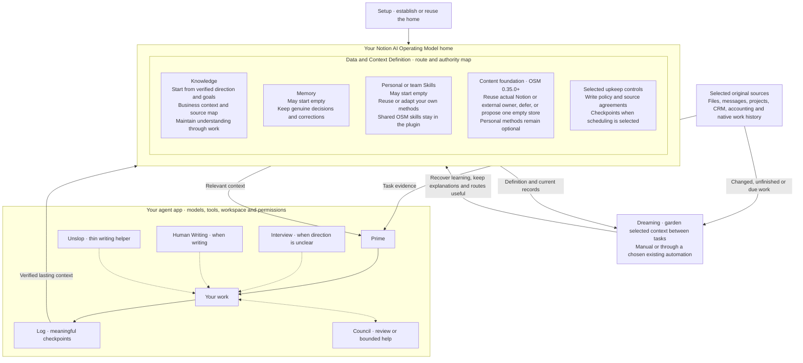

# Start with one useful task

Use this guide to give your assistant a Notion home for business
knowledge, decisions and methods. Install from the approved edition for your
app and check its [released capabilities](https://github.com/onlinesourdough/OSM-plugin/releases).
The Prime and Log walkthrough requires OSM 0.33.0 or later.

## 1. Install and connect

Follow [Install in your app](https://github.com/onlinesourdough/OSM-plugin#install-in-your-app),
then ask your assistant to set up OSM using your chosen Notion page, or choose
**OSM:setup** from Codex's skill picker. Name OSM explicitly; bare `/setup` can
select another plugin. Reuse an
existing working connection and verify a scoped read in the intended account.
OSM uses Notion for the context home. Your documents, project files and
operational systems keep their originals. Use the
[agent workspace guide](native-installation.md#start-with-a-clean-agent-workspace)
to check the host's instructions, tools and approvals.

## 2. Map only what the first task needs

Have Setup reuse suitable pages and databases. The Data & Context page has one
definition followed by its native destinations. Use the repository's
[root template](../skills/osm-data-context/assets/data-and-context-root.md)
for the definition itself. Copy the template, then replace its placeholders
with the company's actual Notion home, account, databases, selected sources
and write policy. Keep one active definition. For example, a design studio
might map client decisions to Memory, methods to Skills, and current invoices
to its accounting system. Add that last route only after it can be verified
under the studio's own account and scope.

| Place | What belongs there |
| --- | --- |
| Knowledge | A concise explanation of your offers, audience or how work is done |
| Memory | Lasting decisions, corrections and their evidence |
| Skills | Reusable methods you actually use |
| Content foundation (OSM 0.35.0+) | The selected Notion or external owner, a recorded deferral, or one proposed empty store; personal editorial methods remain optional |
| Source agreements | The account, scope, reader, authority and freshness of a selected source |
| Operating policy and checkpoints | The exact route to your write rules and, if selected, the existing run state |

### Database fields to start with

Reuse equivalent fields on an existing database. The Notion-authored
[database field definitions](../skills/osm-data-context/assets/database-fields.md)
name useful starting fields, optional additions and their meanings. They are
exported with the definition template; no second starter schema is maintained.
Preserve an existing Source client label, use Evidence for the actual provenance,
and keep creating, editing, source, import and revision dates distinct.

Use `Current` for records selected for normal use with supporting evidence,
`Needs review` when the evidence is missing, disputed or contradicted, and
`Superseded` when a replacement is known. A passed Review due calls for a
check. For live or time-sensitive facts, read the owning source. Link the
replacement in the page body. Add a relation only if the team needs to
follow replacement chains regularly.

Use the Key for a stable topic, such as `first-client-review-day`. A change
from Tuesday to Wednesday then updates the same decision. Keep the reason
and the exact evidence reference with it. Keep Source date, Imported and
Revised distinct. Use Review due when there is a useful date to check again.

Knowledge's temporal scope describes the period as Ongoing or Historical.
For Skills, Audience is Personal or Team. Set Owner when a real maintainer
is known. Notion sharing determines access. Space, Audience and views help
people find things. Check visible records for an existing Key before creating
one. Record source authority in the source agreement. Give a new field a
specific lookup or maintenance purpose before adding it.

Use a native New-menu template if you already have one. Keep its body simple:
Summary and evidence for Knowledge, decision and reason for Memory, and
trigger, procedure and checks for Skills. Verify the saved template and one
record created from it if native templates are part of the setup.

Prefer an existing connector or provider sign-in. If the source needs a key,
use the selected runtime's credential store and
[verify the specific permissions](../skills/osm-setup/references/credentials.md).

## 3. Try one decision across two chats

In this fictional example your current offer is owned by an existing service
page. Start a chat and ask:

> Use our current service page to draft a client reply. Tell me what you found
> there before drafting.

Check the source and the reply. Then give a real, lasting correction or
decision, such as “Please remember that we schedule the first client review
on Tuesdays.” Log saves the decision if your policy allows it. In a fresh
chat, ask what day you schedule the first review and where the answer came
from. Check that the new chat can find the decision and its evidence.

## Keep the setup useful

Prime loads the context a task needs. Log retains useful decisions at
checkpoints and when you ask. Authorised Notion pages follow their destination's
useful format. Optional Dreaming checks recent work and due
sources between sessions, corrects supported errors and leaves live values in
their source systems.

When resuming or migrating, start from the same Notion home and verify its
current sources. A missing or revoked connection shows up as a specific gap.
The [recovery guide](recovery.md) covers restoring a previously working route.
