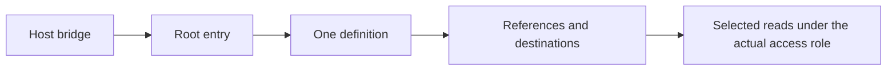
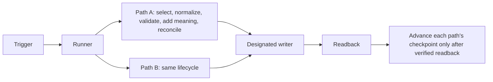

# OSM Context Architecture

This is the one shared contract for a customer's Data & Context home. Setup
adapts it to the customer's actual systems, access, existing stores and business
questions; Maintain Context executes it; Check diagnoses it read-only; Update
preserves owner extensions and history. Skills reference this file instead of
restating it. It is plugin method, never customer data: do not copy it into the
customer's workspace, generate an architecture page there, or preload it during
ordinary use. Fictional examples: [workspace A](../assets/examples/workspace-a.md)
and [workspace B](../assets/examples/workspace-b.md). Procedures for moving an
existing layout are in [migration](migration.md), and
the first-run sequence is Setup's [bootstrap](../../osm-setup/references/bootstrap.md).

Older references say *guide*, *entry* or *selected guide*. Where they mean the
agent's starting page, read that as the **root entry** defined here. Existing
separate-entry layouts remain supported; see [superseded defaults](#superseded-defaults).

## Root and entry

- **One neutral root.** OSM is the method and plugin, not the customer's brand.
  A new root defaults to the title "Data & Context" with a simple neutral icon;
  the owner may choose any title. Identify the root by its stable ID and its role,
  never by title.
- **The root is the one agent entry.** It holds a short orientation, the
  complete essential operating rules, ONE Data and Context Definition YAML block
  and the useful native child destinations. Template:
  [data-and-context-root](../assets/data-and-context-root.md).
- **No extra stores.** No separate mandatory model page, explainer hub,
  architecture database, duplicate definition or empty compatibility scaffolding.
  Exactly one active definition exists per root; a second active YAML is a
  conflict to reconcile, never a fallback.
- **Small entry, deep references.** Detailed semantics, source contracts, field
  dictionaries, writing/recovery and progress rules sit behind references (this
  file, provider references or the customer's own supporting pages). The entry
  stays small so retrieval can be progressive.
- **Existing definitions.** When an existing definition moves into a root, keep
  its compatible field names and extensions. Never regenerate owner choices from
  the template.

## Areas and storage roles

The five **areas** are navigation and coverage, not databases: Business and
relationships; Work and knowledge; Communication (meetings, email, chat,
messages); Finance; Products, market and operations. An extension such as HR,
inventory or legal needs a lifecycle, query or access reason; otherwise it is a
discovery prompt, not empty scaffolding.

The storage **roles** are complementary, not mutually exclusive bins. One list:

| Role | Holds | Usual place |
| --- | --- | --- |
| Profile and collaboration rules | Who the owner is and how to work together | The root's essential rules; optional short About/Soul page |
| Curated business knowledge | One independently useful business topic or delivered result per entry, with evidence | The root's own store. #69 calls it the root's own Docs. Default label for a new root is **Knowledge**; an existing owner label (for example Docs) is kept |
| Memory | Durable decisions, reasons and corrections with provenance | Existing Memory, or a native child of the root |
| Methods | Personal and team Skills | Native Skills |
| Operational sources | Live state with its own owner: tasks, projects, CRM, accounting | Their canonical system; see [placement](#placement-and-projections) |
| Optional typed records | Entities and scoped datasets with a demonstrated query or lifecycle need | A typed destination inside the approved boundary |
| Definition and operational control | The definition, pipeline agreements, source/index/semantic-control records, progress and checkpoints | The root and its existing maintenance/supporting pages; [protected](#protected-records-and-writes) |

The knowledge store is not an all-data database, and Docs is not a sixth area.
The default grain is one useful topic or deliverable; a channel, source or agent
session does not imply its own document or database, and several sources can
support one topic. Reuse existing entity and lifecycle owners (Clients,
Projects, Tasks, code, editorial). No shadow CRM, task tracker, raw archive or
physical bronze/silver/gold copies. System-control and reference material
defaults to the existing maintenance/supporting pages; a legacy one found inside
the knowledge store is still protected by its role.

### Knowledge metadata

Expose meaning before any body read, mapped onto compatible existing fields
(physical names may differ):

| Logical field | Meaning |
| --- | --- |
| Summary | Concise supported meaning, never stronger than its evidence; hypotheses marked per claim |
| Kind | What the content is (client context, decision record, offer, method result), never the source type |
| Temporal scope | Ongoing or Historical: the period the entry speaks about |
| Evidence basis | Attribution and evidence types following actual provenance |
| Source period | The dates the evidence covers |
| Selection/quality state | Whether it is selected for use, needs review or is superseded |

A client topic supported by meetings and chat is client context, not "Meeting".
Historical describes the period; Superseded means replaced; Needs review is
useful uncertainty, never age alone. Ongoing/Historical must not collide with an
existing Status=Current. During migration keep legacy Type/Category values and
hide obsolete dimensions instead of deleting values; see
[Notion schema](notion/schema-and-templates.md).

## Meaning, authority and time

Every retained record or claim states, where known: identity and grain; owned
versus derived authority; source and target identities; source date and observed
revision versus retrieval time; attribution and evidence; uncertainty;
relationships; lifecycle; coverage; exclusions and retention.

- Unknown stays unknown. An extraction is not confirmation, and code or schema
  validation alone is not truth. Missing or unmapped values stay unknown or pending.
- A later owner correction is never overwritten by a source edit or a
  re-extraction. Agent-authored records keep their provenance.
- Original-source authority, curation time and last-confirmed freshness are
  separate facts.
- **Meaning** makes a value usable for its question. Where evidenced it carries
  the entity; unit, period, basis and status; source authority; the reason; and
  relevant relationships. Missing semantics stay unknown. Enrichment never
  invents a confirmation, a causal explanation or a confidence score.
- Retain useful relationship, milestone and personal significance with its
  basis. An owner-valued preference needs attributable owner evidence; revenue
  or invoice count never proves liking or satisfaction. Repetition never
  upgrades a hypothesis to a fact.

### Times and validity

Keep four times apart wherever they exist: source/event time,
observation/import time, explicit confirmation, and effective validity period.

- Recency may rank otherwise relevant, valid evidence. It never establishes
  authority and never automatically supersedes a standing decision; an older
  approved decision outranks newer speculation.
- A fresh import does not reconfirm an old fact; the event date stays the
  source's date.
- Freshness expectations are chosen per data type and question and recorded in
  the [pipeline agreement](#pipeline-agreement). There is no universal decay
  score, expiry or deletion: a historical invoice stays valid for its period,
  while a current balance older than its question's expectation is reported
  stale with its observation time.
- Reconcile authoritative corrections and conflicts. Useful uncertainty becomes
  Needs review. Superseded knowledge stays out of current answers; authorised
  history is retained.
- **A date-only value with a null end and a null timezone is one calendar date**:
  the day the source states. It is not missing coverage, an open-ended or
  ongoing period, an unknown time or, by itself, a reason for Needs review. Keep
  it as that date; invent no time of day or timezone, and never let a conversion
  move it to another day. This is deterministic handling.

### Structured and finance semantics

These live in referenced domain contracts, not in the entry YAML: units,
currency and sign; gross versus net; dates and timezone; status mappings that
keep the original value; null semantics (unknown, not applicable, zero and the
date-only rule above are different); join keys and cardinality; metric formula,
basis, inclusions and exclusions.

- A claimed total needs complete validated rows for its stated scope and basis.
  Never sum only rows an agent selected. Missing coverage is not zero; an
  incomplete scope gives an explicitly partial result with its coverage.
- An unmapped status stays pending with its original value; an ambiguous date or
  unit stays pending unless a recorded deterministic rule resolves it.
- Invoice is not payment. Transfers, refunds, fees, credit notes and currencies
  need explicit mappings. A first or third invoice claim needs defined
  invoice/payment/credit-note semantics and complete relevant history; with
  partial coverage it reads "first observed in the covered period". Backfills
  and corrections re-derive dependent claims and keep history.
- Finance starts from a suitable accounting source; direct bank intake only for
  an actual unmet question. Source credentials for finance are read-only. Real
  finance onboarding is owner-deferred; examples and fixtures are fictional.

## Preparation lifecycle

Every selected pipeline follows: **select → normalize → validate → add meaning →
reconcile → write/readback → advance only verified progress**. No step is
skipped, and no successful checkpoint crosses unread or unverified work.

- **Deterministic work**: typed parsing, exact source identity, dates and
  timezones, currency/units/sign, known status mappings, pagination and
  completeness, stable comparison and financial calculations.
- **Interpretive work**: agents may help select and interpret narrative meaning,
  keeping source evidence, attribution, uncertainty and later owner corrections.
  A narrative proposal is not a decision.
- **Raw originals stay upstream.** Processing may be transient. The home receives
  selected usable content or typed data with evidence, meaning, coverage and
  freshness; a restricted reader must find enough retained substance, not only
  inaccessible upstream links. Progressive quality is adapted from medallion
  principles without mandatory physical layers or any Databricks transaction or
  analytics guarantee.
- **Reconcile** by identity and meaning: cross-source corroboration adds evidence
  to the one owning record; it never creates a second record. Unchanged replay
  writes nothing and rewrites no content.
- **Write/readback** compares meaning: an equivalent formatting difference passes,
  while numbers, links and code spans are compared exactly. An uncertain write
  holds that path's progress until it is reconciled; never retry blindly.
- **Mapping and transform versions** are recorded. A changed rule is deliberately
  reconciled or replayed, never silently applied to old data.
- **Unread media** stays pending, not empty, and blocks its checkpoint.

The three provider classes share this lifecycle with different domain rules:

| Class | Example |
| --- | --- |
| Accounting records | Invoices are parsed into typed rows with currency, sign, period and status mappings; a total is published only over complete rows for its stated basis |
| Original-document excerpts | A selected section is retained with its source identity, authority, observed revision and refresh state; the original stays where it is |
| Meeting text | Supported decisions with reasons, constraints and open questions are retained with attribution; routine chatter and raw transcripts are not |

### Pipeline agreement

Each selected pipeline has one versioned logical agreement, kept as a protected
control record and referenced from the definition. Its fields:

| Field | Records |
| --- | --- |
| Version | Agreement, mapping and transform versions |
| Purpose | The question or outcome it serves |
| Source scope | Authorized source, account and scope by identity |
| Read route | Actual adapter/tool route and account |
| Grain | Entity grain or topic |
| Item key | Stable item key and revision semantics |
| Mappings | Source→target fields and business meaning, onto compatible actual fields |
| Meaning fields | Entity, unit/period/basis/status, authority, reason, relationships, each with the evidence it needs |
| Gates | Quality and coverage gates |
| Target | Actual target identity and the one designated writer |
| Authority | Original versus derived |
| Change rules | Refresh, change, deletion and exclusion behaviour |
| Replay | Replay limits |
| Freshness | Expectation per data type and question |
| Runner | Actual runtime that executes it |
| Trigger | Trigger and cadence, or manual |
| Limits | Processing limits |
| Progress | Checkpoint and error owner |

### Pipeline, adapter, runner and trigger

- A **pipeline** is a repeatable selected source-to-result path, not necessarily
  one per provider, database or background process.
- An **adapter** is the supported tool route; existing API/MCP tools may serve,
  and a custom service is optional.
- A **runner** executes paths. One bounded runner may execute several selected
  paths; each keeps its own source progress, errors and checkpoint, so one path
  never advances or rolls back another. All writes go through one designated,
  coordinated target writer; a second invocation for a held path/target is held
  or is a no-op.
- A **trigger** starts the runner. Never duplicate schedules for the same paths.
  There is no compulsory service, worker or timer per source. A separate event
  worker is a deliberate customer-specific choice when latency, volume or
  reliability warrants it, and needs its own scope.

## Placement and projections

Setup discovers the actual tools, accounts and canonical owners, reuses known
answers and qualifies one useful path before claiming full coverage. For each
operational source the customer chooses: **direct** canonical access, a scoped
Notion **projection**, or **both** with distinct purposes. Existing Notion
Tasks/Projects normally stay canonical through their actual selected data
sources; narrative knowledge holds no duplicate live state. External task or
project software is used directly or projected, as chosen.

A projection carries stable IDs, actual useful substance, coverage and as-of
freshness, and original authority. It is not a second task system and has no
implicit bidirectional writeback; a projected answer states its as-of time.

**Source lifecycle** is an explicit customer choice per source: current recurring,
historical one-off, deferred need, or excluded. Ask first what the customer uses
and which outcomes matter. An installed connector, an accessible archive or a
new login activates nothing; an inactive archive is not a missing daily
pipeline, and a deferred source is shown as deferred, not empty.

## Human originals and selected excerpts

Human originals (a person's Business Docs, personal Docs and other workspaces)
keep their structure, authorship, layout, templates and ownership. Installation,
Setup and Maintain never reorganise, overwrite or bulk-import them, and they are
never an automatic curation destination. Explicit, task-authorised work on a
human document updates its canonical original, never a copy, and is recorded.

An excerpt from an outside original needs an explicitly selected, qualified
read-only source/collector route with its own actual scope. Each excerpt records
source and target identity, original authority, provenance, observed revision,
source date, meaning, uncertainty, chosen coverage and refresh state. No
whole-library mirror or competing full copy. A link recorded in the YAML grants
nothing.

## Access roles

Reader, collector and curator are different roles with different credentials.

- **Recommended internal connection**: grants one selected root and its intended
  descendants, with content read, insert and update. A root-only credential
  cannot read outside originals merely because the definition links them.
- **Scope**: both narrowly selected pages/databases and a deliberately broader
  owner-selected Notion scope are supported. Broader access activates no
  ingestion and grants no authority to rewrite human libraries.
- **What grants access**: only the provider's actual grants. Root links, views
  and labels never do. Discover the actual parent/source identity instead of
  assuming a linked view is the grant target. The integration's content
  capabilities apply across all its granted sources; never claim per-page
  read-only enforcement from prompts or labels.
- **Dedicated destinations** are justified by access inheritance: existing
  individually granted pages stay canonical, while new records need a qualified
  parent with suitable inherited access. Never widen a business database to make
  creation work. Trash is qualified separately under explicit action authority:
  no purge and no standing daily delete. No user-directory, comments or
  agent-session permissions by default.
- **Official connection**: an explicit alternative, never a silent fallback and
  never evidence for the narrower route. A host that keeps broader tools is not
  an isolated agent.

These rules are generic. They do not answer the pending concrete read-set and
access gate for any installation.

## Protected records and writes

Source, index and semantic-control records (the definition, pipeline agreements,
source maps, mapping tables, progress records) are protected by their actual role
or exact identity wherever they live, including inside the knowledge store. A
destination-level allowlist alone is not enough.

- Routine curation writes only authorised curated knowledge, Memory and bounded
  progress, to an explicit destination allowlist.
- It never writes human originals, standing policy, source authorization,
  schema, sharing, Skills or deletions, and it refuses canonical operational
  writes (for example selected Tasks/Projects) even when its credential can see
  them. Task-authorised operational work uses its own selected qualified route.
- Unknown or inaccessible sources stay pending; recording a link activates no intake.

## Retrieval

From the small root entry, select by metadata first (definition routes, then
knowledge metadata), then read only the bodies selected. A representative
request should reach its retained result within three page bodies without a
whole-library or history preload; a path needing more is widened deliberately
and said so. Rank by authority, then relevance, then recency: the live owning
record, then current Memory or curated knowledge including owner corrections,
then confirmed evidence, then extraction candidates, then uncertain claims.
Superseded, quarantined and unavailable material stays out of current answers
and may appear only as labelled history.

## Host bridge, map, connector and trigger

Four distinct things:

1. A **host instruction bridge**: the thin global or project pointer (see
   [the bridge](../assets/bridge.md) and the
   [Claude adapter](../../osm-setup/references/adapter-claude.md#context-setup)).
2. A **context map**: the definition in the root.
3. A **source connector**: the adapter route a pipeline uses.
4. An **execution trigger**: what starts a runner.

Global host instructions stay thin and carry no company data. Pointer
configuration and observed instruction loading are never proof of credentials,
tool access, enforced permissions, live ingestion or a timed run. A bridge is
reported loaded only with recorded evidence: client and version, the instruction
files present in the working directory and above, the instruction-loading
setting and where it was set, and an observed load in a fresh session;
otherwise it is unverified. During a root change, every selected host pointer is
reconciled to the new root in the same authorised change (procedure:
[migration](migration.md#root-change-and-host-pointers)).

## Root navigation and Home

If the knowledge store (or the existing Docs), Memory and Skills are already
native children of the root, Setup adds no second manual link list to the same
objects. Keep one understandable root layout. Home and any other consumer read
the canonical definition or the native child references by exact ID and readable
title, expose each destination once by identity, preserve the exact root title
and report their actual parsing and completeness limits. Dated, verified panel
shortcuts are a compatibility aid, never a second source of authority.

## Readiness and evidence

Each state is reported on its own, with its observation time:

- **Source states**: availability, authentication, plan entitlement, permission
  scope, completeness, and a verified destination write.
- **Run states and evidence classes**: definition/configuration (reported as
  configured); manual end-to-end qualification (that run's receipt); saved
  schedule; and actual scheduled or event execution (only an observed timed run
  with a read-back checkpoint). Configuration or a manual success is never
  scheduled readiness.
- An unchanged run makes zero writes. Unknown, blocked and deferred are visible
  states, never shown as empty or zero. The official connector's Connected badge
  is never proof of the internal runtime.

## Diagrams

Agent startup and data access:

Pipeline preparation:

## Superseded defaults

These earlier defaults are superseded for new setups. Existing layouts keep
working until an explicit [migration](migration.md).

| Earlier default | Replaced by |
| --- | --- |
| A separate mandatory AI Operating Model page holding the definition, plus an OSM-branded home ([OSM page](../assets/notion-osm.md)) | One neutral root with one definition ([Root and entry](#root-and-entry)) |
| A human Business Docs or Document Hub library as the curation destination | The root's own knowledge store; human originals stay untouched ([Human originals](#human-originals-and-selected-excerpts)) |
| The official Notion plugin connection as the setup route | The recommended internal root-only connection; official mode is an explicit alternative ([Access roles](#access-roles)) |
| Writes allowed by a destination-level allowlist | Protection by role or exact identity ([Protected records](#protected-records-and-writes)) |
| Docs Type = Context/Source/Document, with Status=Current as selection | Knowledge metadata ([Knowledge metadata](#knowledge-metadata)) |
| A mandatory source → atom → Memory chain | Durable meaning with evidence at its owning record; separate claim records only for a demonstrated need |
| A manual link list on the root for native children | Native child references read by identity ([Root navigation](#root-navigation-and-home)) |

## Proof boundary

The repository's offline rehearsal checks fictional fixtures against these rules.
That is fixture-level proof only. Real permissions, inheritance, outside denial,
host isolation, instruction loading, adapters, Home behaviour and actual timed
success each need their own live or native proof.
